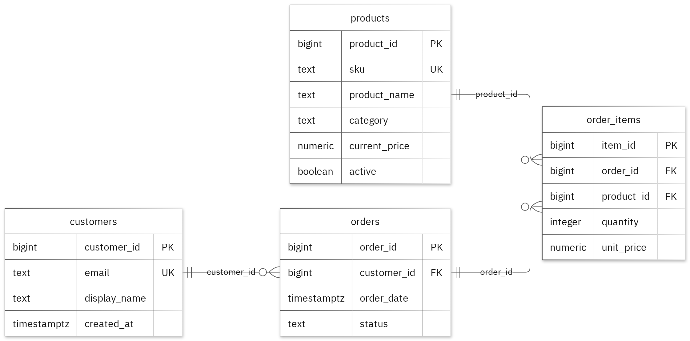

# MIT 8103 Advanced Database Systems

**E-commerce Platform** · Joshua Kolo · Student ID 301905772

## Case study

My case study project is centred around an E-commerce Platform. The database for customers placing and reviewing orders, as well as store attendants been able to review order activity, with separate tables created for customers, products, orders and order_items. It supports the following operations: create an order and add product line items; find a customer's recent orders; summarize units and sales by product.

## Portfolio 1: Database Design and Modelling

The relational design was carefully organised into 4 tables. Primary keys identify records, foreign keys preserve the links, and checks enforce the stated business rules. A customer may have at most one order whose status is cart; enforce a partial unique constraint on customer_id for rows with status cart. The normalisation examples show the sample data at 1NF, 2NF and 3NF. All 12 deliberately invalid inserts were rejected without changing the valid sample rows.

Figure 1. Tables, keys and relationships. PK: primary key; FK: foreign key; UK: unique value.

<!-- PAGE BREAK -->

## Portfolio 2: Query Processing and Optimisation

I ran three SQL queries against the sample records. The join returned 2 rows and included ava@example.test with MUG-001. For the index comparison, I used 20,000 separate performance rows. The median lookup time changed from 1.129 ms to 0.175 ms. Both phases returned the same records. The measured plan used the new index. These timings apply to this lookup and environment.

## Portfolio 3: Transactions and Concurrency

For this task, I made use of a temporary counter on orders to test COMMIT, ROLLBACK and READ COMMITTED isolation. The uncommitted update(s) were kept hidden from the other session, and subsequently the ROLLBACK restored the earlier committed value. Without locking, two increments left the counter at 2. With SELECT FOR UPDATE, Session B waited for Session A and the final value was 3. The helper is confined to this exercise; the case's original business fields stay unchanged.

## Portfolio 4: NoSQL and Advanced Data Models

I used order_events for the case's event documents. MongoDB inserted 4 sample events and returned the expected results for 4 queries. Validation rejected an invalid date type and a duplicate event ID. Embedded snapshots keep related details with an event, while the details field can differ by event type. These are fictional events; PostgreSQL continues to enforce its relational rules.

## Repository and evidence

https://github.com/Joshuakolo/Kolo_Joshua_301905772

The portfolio folders contain the SQL and JavaScript, explanations, query plans, result tables and screenshots.

<!-- PAGE BREAK -->

## Portfolio 5: Distributed and Cloud Database Exercise

Three MongoDB replica members were proposed across separate failure zones. This primarily covers elections, majority acknowledgement, secondary lag and sharding trade-offs for order_events. Replication supports availability, while backups address recovery. PostgreSQL needs its own availability plan. This is the permitted discussion option; no live replica set or failover test was deployed.

## Individual reflection

I organized my Project database by keeping customers, products, orders, and order items in separate tables. And as a result of this, I can easily manage their details without duplicating information across different records. It is important to note that a customer can have only one order that has the status of "cart." To ensure this, I had to prompt the set up of a special unique constraint on the customer ID for those cart orders. 

I also learnt an interesting lesson during a two-session exercise: both sessions could read the same data before either made an update. To avoid issues with this, I had to carryout a few research and consult with those knowledgeable in this field and after that a conclusion was made and I locked the row before reading it, which helped preserve the increments correctly. 

Additionally, I realized the importance of checking the execution plan along with the final results. In some instances, achieving the same outcome can require varying amounts of effort from the database, so understanding the underlying processes is crucial.

## AI-use declaration

For this E-commerce Project, the following AI tools were deployed to help with the project; GitHub Copilot and the portfolio generator to help prepare the database model, scripts and explanations. The generator ran the PostgreSQL and MongoDB exercises, carefully checked their outputs and captured the result images. However for the checking, compiling & explaining of the submitted work itself, that was done by me.

## References

- [PostgreSQL: constraints](https://www.postgresql.org/docs/17/ddl-constraints.html)
- [PostgreSQL: EXPLAIN](https://www.postgresql.org/docs/17/using-explain.html)
- [PostgreSQL: isolation](https://www.postgresql.org/docs/17/transaction-iso.html)
- [PostgreSQL: row locks](https://www.postgresql.org/docs/17/explicit-locking.html)
- [MongoDB: data modelling](https://www.mongodb.com/docs/manual/data-modeling/)
- [MongoDB: replication](https://www.mongodb.com/docs/manual/replication/)
- [MongoDB: sharding](https://www.mongodb.com/docs/manual/sharding/)
- [Mermaid: ER diagrams](https://mermaid.js.org/syntax/entityRelationshipDiagram.html)

